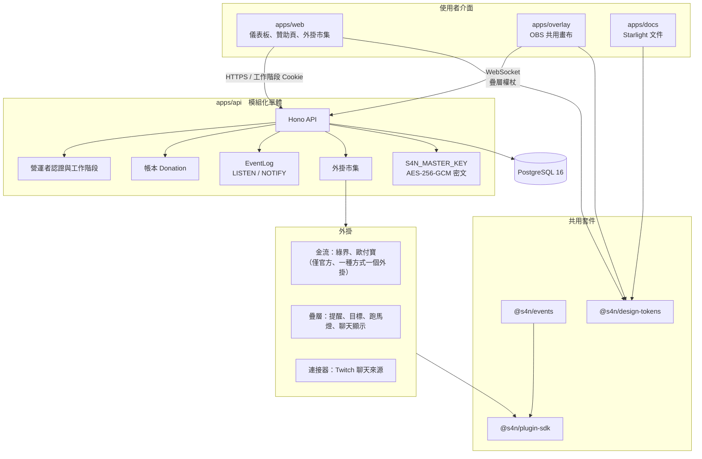

# S4N DONATE SYSTEM 2.0

**開源實況主贊助平台**  
*An open-source, self-hosted donation platform for livestreamers.*

[](LICENSE)
[](https://github.com/Salmon4neko-Studio/S4N-Donate-System-2.0/actions/workflows/ci.yml)

S4N DONATE SYSTEM 2.0 是給實況主自行架設的贊助平台：營運者在儀表板管理金流與疊層，觀眾在公開贊助頁完成付款，OBS 則以瀏覽器來源顯示提醒、目標、跑馬燈與聊天。這不是舊系統的遷移。

設計優先順序是**安全**、**美感**，然後才是開發容易。核心只保留帳本、付款介面、事件匯流排、疊層外殼、外掛密鑰與權限；具體功能以外掛掛上。介面與文件以繁體中文為主。

使用教學與部署步驟不在本 README，請見文件站（來源：[`apps/docs`](apps/docs)）。

> **TODO：** 正式文件網址確認後再填入（例如 Cloudflare Workers 部署完成後的公開網址）。

---

## 架構

本專案是單一 pnpm monorepo 裡的**模組化單體（modular monolith）**：一個 API 程序承載帳本、認證、市集與即時事件，功能則以外掛擴充。官方外掛與核心一起發布；市集以簽過名的索引宣告版本、權限與套件摘要。



正式環境由 Caddy 終止 TLS：儀表板與 API 同一個網域，OBS 疊層使用獨立主機名；PostgreSQL 不對外發布埠。映像推送到 `ghcr.io/salmon4neko-studio/s4n-{api,web,overlay,docs}`。

### 目錄

```text
apps/api             Hono、Prisma、PostgreSQL、疊層 WebSocket、外掛市集
apps/web             Vite、React 19、Tocas UI：儀表板與公開贊助頁
apps/overlay         OBS 瀏覽器來源（共用畫布上的提醒、聊天、目標、跑馬燈）
apps/docs            Starlight 文件（繁體中文）
packages/events      型別化事件契約
packages/plugin-sdk  外掛規格 0.1、權限與付款介面（外掛不直接寫帳本）
packages/design-tokens  品牌色與自託管字體
plugins/             官方與範例外掛（見下方「外掛系統」）
deploy/              正式環境的 Caddy 進入點與備份腳本
```

核心擁有帳本；付款外掛只負責開單與驗證金流通知，通過後由核心入帳。疊層透過權杖連上 WebSocket，依事件序號補齊斷線期間的紀錄（至少送達一次，客戶端以事件 id 去重）。測試贊助只進事件紀錄，不寫入帳本。

---

## 技術棧

| 層面 | 技術 |
| --- | --- |
| 執行環境 | Node.js 22（`engines`: `>=22.13`）、pnpm 10.33.4 |
| 語言 | TypeScript 5.9.3 |
| API | Hono 4、`@hono/node-server`、WebSocket（`ws`） |
| 資料 | Prisma 7.10、PostgreSQL 16（`postgres:16-alpine`）、`@prisma/adapter-pg` |
| 前端 | Vite 8、React 19 |
| 儀表板 / 贊助頁 UI | [Tocas UI](https://tocas-ui.com/) 5.7，輔以自訂元件 |
| 字體 | 本機自託管 [jf open 粉圓 2.1](https://github.com/justfont/open-huninn-font/releases/tag/v2.1)（justfont，SIL OFL 1.1），不連外部字型 CDN |
| 疊層樣式 | 獨立樣式；共用同一字型家族。建置使用 Tailwind CSS 4 |
| 文件 | Astro 7、Starlight |
| 部署 | Docker、Caddy 2.10、GitHub Actions、GHCR（`linux/amd64`） |

品牌主色是 `#F28500`。實心按鈕使用該色填色，文字為 `#1a1512`。

---

## 外掛系統

外掛規格為 0.1，清單與權限宣告在各目錄的 `s4n-plugin.json`。官方外掛是**明確允許清單**，不是看到 `official.` 前綴就放行。金流外掛只有官方索引裡點名的方式可以安裝，而且一種付款方式對應一個外掛。

### 金流（僅官方）

目前已列入官方索引、並由核心載入的付款方式：

| 外掛 id | 說明 |
| --- | --- |
| `official.ecpay` | 綠界信用卡（一次付清） |
| `official.ecpay-atm` | 綠界 ATM 虛擬帳號 |
| `official.ecpay-cvs` | 綠界超商代碼 |
| `official.ecpay-barcode` | 綠界超商條碼 |
| `official.opay` | 歐付寶信用卡（一次付清） |
| `official.opay-atm` | 歐付寶 ATM 虛擬帳號 |
| `official.opay-cvs` | 歐付寶超商代碼 |

`plugins/opay-barcode`（歐付寶超商條碼）已有原始碼，但**尚未列入官方索引**，這個版本也不會被核心載入。

付款通知與瀏覽器導回走 `/api/payments/:pluginId/callback` 與 `/return`。外掛以常數時間比對檢查碼並核對商店代號與付款方式；核心只在金額等於伺服器訂單、且廠商交易編號一致時入帳。取號（ATM／超商）只把訂單改為待繳費，不入帳、不送提醒。

### 疊層與連接器

| 外掛 id | 說明 |
| --- | --- |
| `official.alerts` | 贊助提醒：範本、顏色、動畫與提示音 |
| `official.goals` | 目標進度：只計算帳本中已入帳（`succeeded`）的贊助 |
| `official.ticker` | 跑馬燈：純文字，可接最近贊助 |
| `official.chat-overlay` | 聊天顯示：只訂閱已正規化的聊天事件，不連到任何平台 |
| `official.twitch-chat` | Twitch 聊天來源：伺服器以匿名 `justinfan` 讀取 IRC |

提醒、目標、跑馬燈與聊天顯示共用同一條 OBS 網址、同一張畫布。Twitch 的選填 Client ID / Client Secret 以密文保存，不會出現在 OBS 網址。

`plugins/example-thanks` 是可編譯的社群疊層範例，未進入官方目錄。這個版本對權限落在疊層與儀表板範圍內的社群外掛，最多只記下安裝狀態，**不會執行其程式**。

---

## 安全性

主要設計如下。完整說明見文件站的〈安全性〉。

- **主金鑰與密文：** 伺服器只放一把 `S4N_MASTER_KEY`（標準 Base64，解碼後為 32 位元組）。外掛密鑰以 AES-256-GCM 密封，附加驗證資料綁定外掛 id 與欄位名，密文不能挪到別的欄位。儀表板只顯示「已設定」或「未設定」，不回傳明文或密文。全零的開發用金鑰在正式環境會拒絕啟動。
- **官方索引簽章：** `official.json` 以 Ed25519 簽署，公鑰釘在 `apps/api/src/plugins/marketplace/pinned-key.ts`。私鑰不在版本庫。沒有簽章、內容被改、或鑰匙不對的索引都不會被採用。套件摘要是正規化 `s4n-plugin.json` 的 SHA-256。
- **金流隔離：** 只有允許清單上的官方付款外掛能使用 `payments.provider`、`secrets`、`network`。社群外掛不能成為付款提供者。入帳金額以伺服器訂單為準，不以廠商通知裡的金額覆寫。
- **認證與工作階段：** 密碼為 Argon2id。Cookie `s4n_session` 為 `httpOnly`、`SameSite=Lax`，正式環境加上 `Secure`。會改變狀態的儀表板請求須通過來源允許清單。付款回呼不看 Origin，改由外掛驗簽。
- **疊層權杖：** OBS 不使用登入 Cookie。權杖以 SHA-256 查找，並用主金鑰密封以便儀表板再次顯示網址。重新產生後舊權杖立即失效。
- **不可信內容：** 贊助人名稱、留言與聊天文字不以 HTML 解讀。提示音只接受經 MIME 與檔頭檢查的音訊檔，路徑限制在音效目錄內。
- **部署面：** API 與靜態服務映像以非 root 使用者執行；正式 Compose 不發布資料庫或 API 埠，僅由 Caddy 對外提供 80／443。不要把 `.env` 或真實密鑰提交到版本庫。

目前尚無內容安全政策（CSP）。登入限流與 Twitch 徽章快取仍在單一程序的記憶體裡。

### 回報弱點

若發現安全漏洞，請不要在公開 Issue 貼出可重現的利用細節。回報方式、範圍與揭露原則見 [SECURITY.md](SECURITY.md)。

---

## 開發路線

### 已完成

- [x] 模組化單體與外掛市集（簽過名的官方索引、權限確認、安裝與更新）
- [x] 營運者初次設定、登入，以及伺服器端工作階段
- [x] 綠界與歐付寶：信用卡、ATM、超商代碼；綠界超商條碼
- [x] 帳本狀態（待付款、待繳費、已付款、已過期、待人工處理、失敗）
- [x] 測試贊助（送到疊層，不寫入帳本）
- [x] 贊助提醒、目標進度、跑馬燈，以及 Twitch 聊天疊層
- [x] 以 `S4N_MASTER_KEY` 密封外掛密鑰；密文欄位只顯示已設定／未設定
- [x] PostgreSQL 事件紀錄與斷線依序號補齊
- [x] 正式環境 Compose、Caddy、備份腳本，以及 CI 與 GHCR 映像

### 規劃中

- [ ] YouTube 聊天來源（事件契約與聊天疊層已預留同一份 `s4n.chat.*` 形狀；不必改顯示外掛）
- [ ] 贊助頁自訂（版面與外觀由營運者調整）
- [ ] 多個 API 實例共用的登入限流

語音合成（TTS）已自本版本移除，不會列入後續規劃。

---

## AI 使用聲明

本專案有相當比例的程式碼與文件，是在維護者的指導與審查下，藉由 AI 輔助開發工具（AI coding agents）產出。提交前經過人工檢視，但仍可能存在疏漏。

請在用於正式環境前自行審查、測試，並依實際需求完成設定與驗證。本軟體依 MIT 授權「現況」提供，不對適用性或無錯誤作出保證。授權條款的完整免責聲明以 [`LICENSE`](LICENSE) 為準。

---

## 授權

本專案採用 [MIT License](LICENSE)。Copyright (c) 2026 S4N DONATE SYSTEM contributors。

儀表板、贊助頁與疊層使用的 jf open 粉圓字型，授權為 SIL Open Font License 1.1，檔案與授權全文在 `packages/design-tokens/fonts/`。

---

## 參與貢獻

目前沒有獨立的 `CONTRIBUTING.md`。歡迎透過 [Issues](https://github.com/Salmon4neko-Studio/S4N-Donate-System-2.0/issues) 與 [Pull Requests](https://github.com/Salmon4neko-Studio/S4N-Donate-System-2.0/pulls) 參與。文件與介面文字請使用繁體中文。請勿提交 `.env` 或真實密鑰。
